[LinkedIn](https://www.linkedin.com/in/baskar-raju-baskaruni-8a998124a/) · [Email](mailto:bhaskarbhaskaruni@gmail.com) · [Open-source work](https://github.com/OSS-Project-Agentreckon/StackWinnow)

## About

I'm **Baskaruni Baskar Raju**, a **Scholar@SAP** based in Bangalore, India. I build practical AI applications and developer tools, with experience in enterprise integration and DevOps.

My work spans retrieval-augmented generation (RAG), natural-language-to-SQL, AI agents, and Model Context Protocol (MCP) integrations. I have also worked with SAP BTP, JDBC, and CI/CD automation. I am particularly interested in making AI systems easier to use, evaluate, and maintain.

## Selected projects

### [StackWinnow](https://github.com/OSS-Project-Agentreckon/StackWinnow)

An open-source project that inspects a codebase, explains relevant AI tool recommendations, and provides managed setup and verification for supported tools.

I contributed project inspection, explainable recommendations, bounded source discovery, Graphify integration, and the discovery workbench. My work also includes lifecycle improvements, portable profiles, documentation, and peer review.

**Python · FastAPI · React · CLI tooling · GitHub Actions**

[Source discovery](https://github.com/OSS-Project-Agentreckon/StackWinnow/pull/47) · [Discovery workbench](https://github.com/OSS-Project-Agentreckon/StackWinnow/pull/49) · [My merged contributions](https://github.com/OSS-Project-Agentreckon/StackWinnow/pulls?q=is%3Apr+is%3Amerged+author%3ABASKARUNIBASKARRAJU)

### [Image-to-Ad](https://github.com/BASKARUNIBASKARRAJU/image-to-ad)

A full-stack prototype for turning uploaded images into advertising previews. It combines five visual templates with optional OpenAI image analysis and copy generation, plus a template-only mode.

**React · Node.js · Express · OpenAI API · Tailwind CSS**

### [Reimbursement System](https://github.com/BASKARUNIBASKARRAJU/Reimbursement-System)

An application project covering employee expense submissions, manager review, finance closure, receipt attachments, and administration. The repository contains a Spring Boot backend and React UI source; its README describes the current setup requirements and remaining frontend packaging work.

**Java · Spring Boot · React · MySQL**

## Experience and exploration

At SAP, my work has included AI-assisted validation using SAP AI Core, reusable CI/CD workflows, a Jenkins-to-GitHub Actions migration, and integration between AI assistants and enterprise tools through MCP. My first rotation also included SAP BTP, JDBC, and DevOps work.

Through project work, coursework, and workshops, I have built or contributed to:

- **Natural-language-to-SQL:** retrieval of schema information and example queries, structured query planning, and validation of generated SQL.
- **Document question answering:** document chunking, embeddings, vector retrieval, and answers grounded in retrieved context.
- **Agent workflows:** human approval for proposed shell commands, error recovery, audit logs, and multi-agent support workflows.

These explorations include prototypes and workshop projects alongside my professional work.

## Technologies I work with

| Area | Technologies |
| --- | --- |
| AI applications | RAG, LLM APIs, MCP, CrewAI, FAISS, ChromaDB, sentence-transformers |
| Application development | Python, Java, JavaScript, SQL, FastAPI, React, Spring Boot |
| Enterprise integration | SAP BTP, SAP AI Core, JDBC |
| Delivery and automation | Git, GitHub Actions, Jenkins, Bash |

## Open-source collaboration

I contribute code, review pull requests, and document implementation decisions in StackWinnow. I have also added dependency-update configuration and opened scoped issues for new contributors.

[Example code review](https://github.com/OSS-Project-Agentreckon/StackWinnow/pull/48#discussion_r4681540056) · [Contributor opportunities](https://github.com/OSS-Project-Agentreckon/StackWinnow/issues?q=is%3Aissue+is%3Aopen+label%3A%22help+wanted%22)

## Current focus

I'm continuing to explore reliable agent workflows, context-aware developer tools, and practical evaluation of AI outputs. I welcome conversations about applied AI, automation, and open-source collaboration.

Reach me on [LinkedIn](https://www.linkedin.com/in/baskar-raju-baskaruni-8a998124a/) or at [bhaskarbhaskaruni@gmail.com](mailto:bhaskarbhaskaruni@gmail.com).
